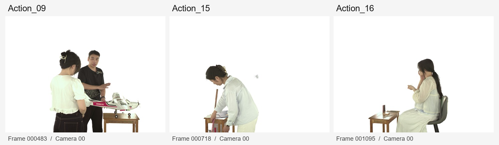
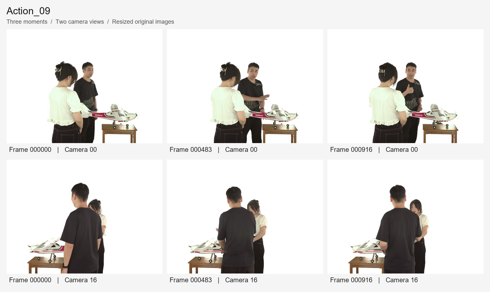
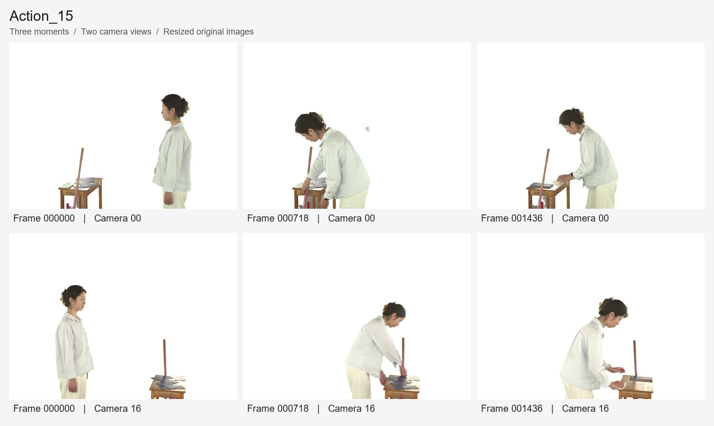
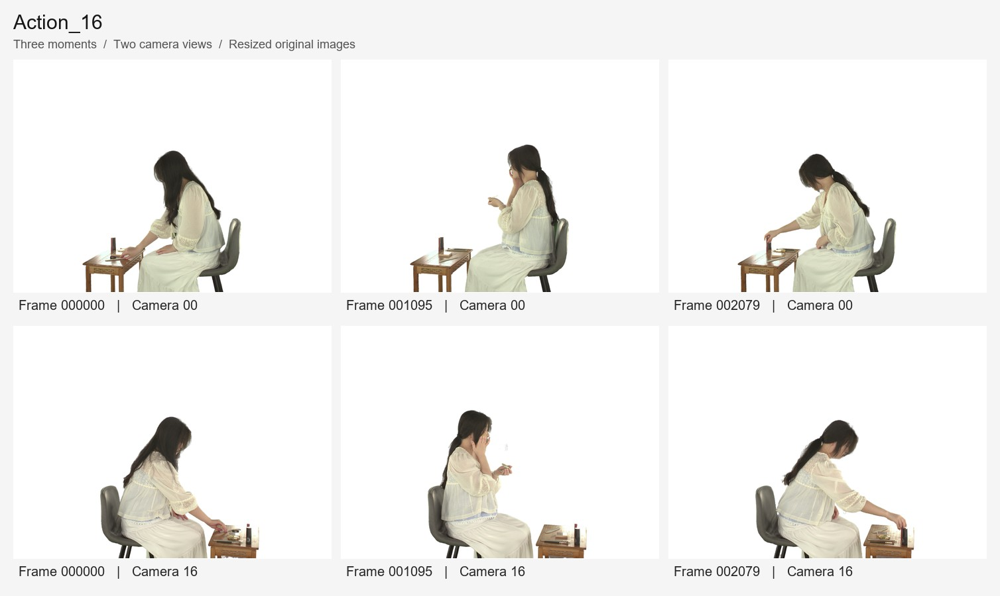

# MoE-3DGS Dataset

Multi-view image sequences for dynamic scene reconstruction, used in MoE-3DGS experiments. The scenes feature human motion and interaction with tabletop objects against a white background.



[Sequences](#sequences) · [Download](#download) · [Data format](#data-format) · [Data notes](#data-notes)

## Sequences

The collection contains **3 sequences, 5,311 temporal frames and 169,951 PNG images**. Each sequence has 32 camera views at **4096 × 3000** resolution. Frame and camera indices are retained in the image filenames and directory structure.

| Sequence | Frames | Views | Images | Size | Download |
| --- | ---: | ---: | ---: | ---: | --- |
| Action_09 | 966 | 32 | 30,911 | 130.37 GiB | Not yet released |
| Action_15 | 2,155 | 32 | 68,960 | 132.23 GiB | [Release](https://github.com/AimerReol/MoE-3DGS-Dataset/releases/tag/action15-v1) |
| Action_16 | 2,190 | 32 | 70,080 | 191.90 GiB | [Release](https://github.com/AimerReol/MoE-3DGS-Dataset/releases/tag/action16-v1) |

Action_09 has one missing image in its final frame; see [Data notes](#data-notes). Sizes refer to the original image files.

<details>
<summary>Action_09: temporal and multi-view previews</summary>



</details>

<details>
<summary>Action_15: temporal and multi-view previews</summary>



</details>

<details>
<summary>Action_16: temporal and multi-view previews</summary>



</details>

Previews are resized for display. The release archives contain the original PNG files.

## Download

Data are distributed through the sequence releases linked above. A Python downloader retrieves the archives, verifies SHA-256 checksums and extracts the sequence directories.

```bash
git clone https://github.com/AimerReol/MoE-3DGS-Dataset.git
cd MoE-3DGS-Dataset
python tools/download_dataset.py --sequence Action_15 --output ./data
```

Requires Python 3.9 or newer; no additional packages are needed. Set `--sequence` to the desired released sequence. See the [download guide](docs/DOWNLOAD.md) for partial downloads, resuming downloads and manual extraction.

## Data format

```text
data/
├── Action_09/
│   └── WhiteBg/
│       ├── 000000/
│       │   ├── 00.png
│       │   ├── ...
│       │   └── 31.png
│       ├── 000001/
│       └── ...
├── Action_15/
│   └── WhiteBg/...
└── Action_16/
    └── WhiteBg/...
```

Six-digit directory names identify temporal frames, starting at `000000`. Filenames `00.png` through `31.png` identify camera views. Archives preserve this layout and the original image bytes.

## Data notes

- **Incomplete frame:** `Action_09/WhiteBg/000965/23.png` is absent from the source data. Action_09 contains 965 complete frames and one frame with 31 views. Action_15 and Action_16 have all 32 views for every frame.
- **Release contents:** the archives contain image sequences only. Camera calibration, segmentation masks and reconstruction models are not included.
- **Temporal metadata:** frame indices are provided; capture frame rate and timestamp metadata are not included. No training/test split is defined in this release.
